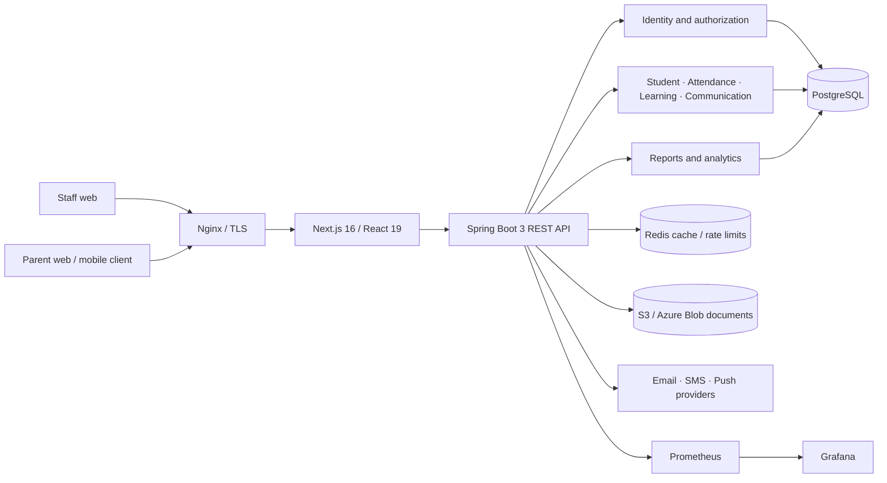
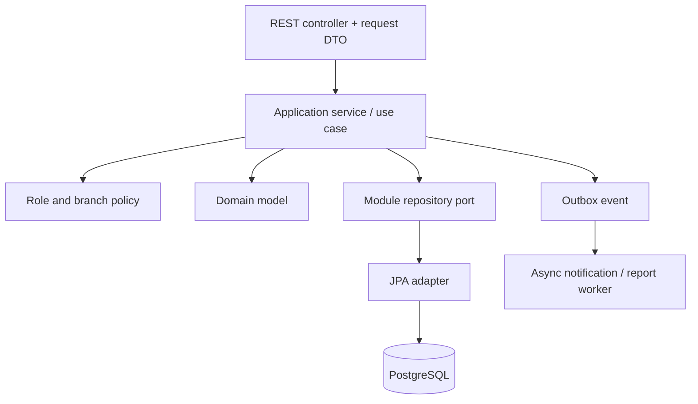
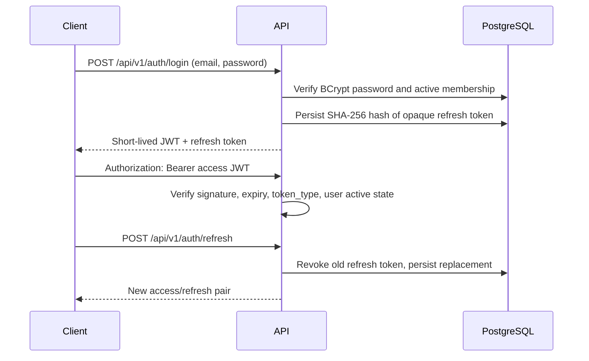
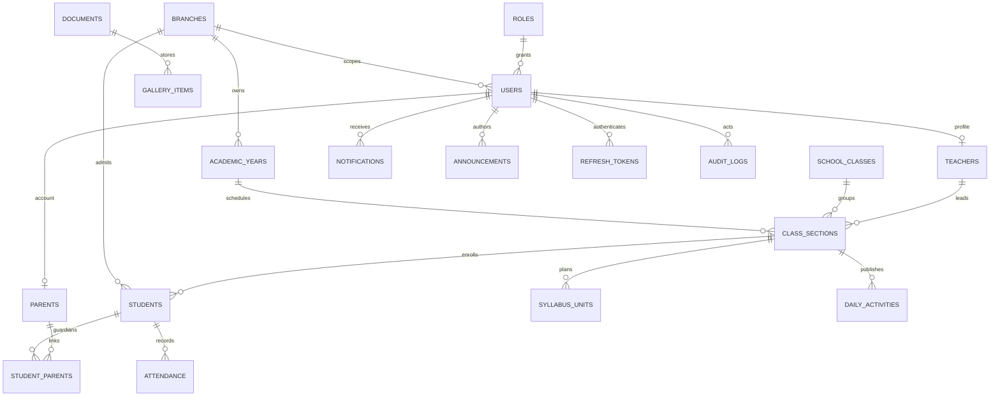

# Little Home School Platform Architecture

## HLD

Start with a modular monolith. Student, attendance, learning, communication, reporting, identity, and branch modules share one Spring Boot deployment and one PostgreSQL database, but own their application/domain/persistence boundaries. This keeps the seven-branch product operable by a small team while allowing high-volume modules to be extracted later from measured bottlenecks.



### Key decisions

- PostgreSQL is the source of truth. Flyway owns every schema change; Hibernate runs with `ddl-auto: validate`.
- Branch scope is a server-side authorization condition, not a client filter. Every application service derives the authorized branch set from the authenticated principal. Super admins may request all branches; other roles may not widen scope using query parameters.
- UUID identifiers are used for externally exposed entities. Audit columns and optimistic `version` fields support traceability and concurrent edits.
- Redis is an optimization for short-lived cache/rate-limit workloads. Refresh tokens remain hashed and revocable in PostgreSQL so logout and rotation survive cache eviction.
- Users retain a default branch for login while `user_branch_memberships` supports multi-branch assignments; the active branch must be authorized server-side for every request.
- Documents are metadata in PostgreSQL and bytes in private object storage. Serve downloads using short-lived signed URLs after authorization.
- Keep analytics queries out of interactive request paths as data grows; materialize/report asynchronously before adding a warehouse.
- Sensitive child data is private by default. Collect the minimum data needed, restrict medical/document access, and retain access audit records.

## LLD

Each feature follows `api -> application -> domain -> infrastructure`. Controllers validate DTOs and map responses; application services own transactions and authorization decisions; domain objects enforce state invariants; repositories are module-owned. Cross-module collaboration uses application ports, not access to another module's tables/repositories.



### Suggested backend package structure

```text
backend/src/main/java/com/littlehome/school/
  identity/       # users, roles, branch memberships, permission policies
  auth/           # login, token rotation, password reset
  branch/         # branch settings and staff scope
  student/        # admission, profiles, guardians, transfers
  attendance/     # registers, correction history, reports
  learning/       # syllabus, activities, homework
  communication/  # notifications, messaging, announcements
  media/          # document authorization and object storage adapter
  reporting/      # branch and school reports
  audit/          # append-only audit writer
  shared/         # API errors, clock, paging, persistence auditing
```

### Suggested frontend structure

```text
src/
  app/                 # routes, layouts, global styles
  components/ui/       # ShadCN primitives
  features/<module>/   # components, schemas, queries, mutations, types
  lib/api/             # Axios transport and auth handling
  lib/query/           # TanStack Query provider and defaults
  stores/              # Zustand client-only preferences/ephemeral UI
  types/               # shared API envelopes only
```

Use TanStack Query for server state, Zustand only for local UI preferences, and do not duplicate server entities into global client state. The current UI dashboard is a clickable prototype with local in-memory student actions; it is not yet wired to the REST API.

## Role permissions

| Capability | Super Admin | Branch Admin | Teacher | Parent |
|---|---|---|---|---|
| Branches, roles, academic year, fees | All branches | Read own branch | No | No |
| Student admission/profile/transfer | All branches | Own branch | Assigned students read | Linked child read |
| Attendance | School analytics/corrections | Own branch manage | Assigned sections mark | Linked child read |
| Timetable and staff | All branches | Own branch manage | Assigned timetable read | Child timetable read |
| Syllabus and daily learning | All branches | Own branch manage | Assigned class create | Linked child read |
| Announcements and gallery | All branches publish | Own branch publish | Create subject to policy | Published content read |
| Reports and audit | School-wide | Own branch | Assigned class | Linked child only |
| Parent-teacher messaging | Policy/support | Own branch oversight | Assigned students | Linked child teachers |

Implement this using method-level policy checks plus branch predicates in repository queries. A role claim alone does not prove access to a particular student or branch.

## Authentication flow



Production browser deployment should place the refresh token in a `Secure`, `HttpOnly`, `SameSite` cookie and the access token in memory. Add CSRF defenses for cookie-based refresh/logout, rate-limit login/reset, prevent user enumeration in password recovery, and use a managed key/secret store. The local API sample currently returns both tokens in JSON for ease of API testing.

## ER diagram



The first Flyway migration contains these relationships plus homework, events, media albums, communication threads/messages, fee structures, transfer history, audit records, and refresh-token storage.